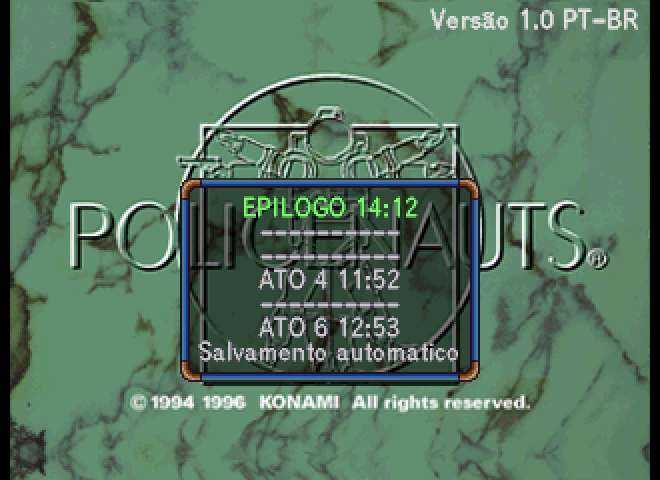
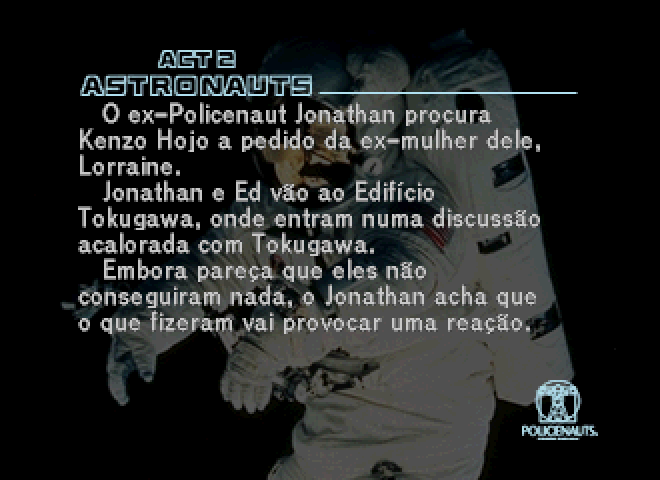
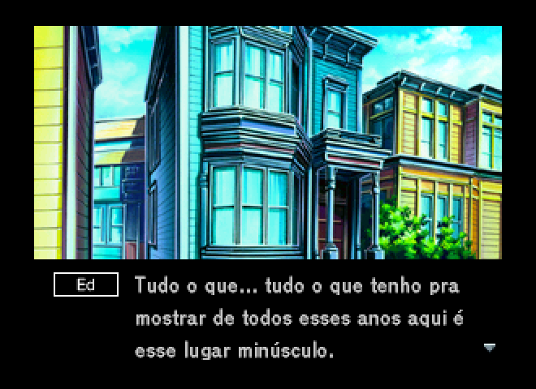
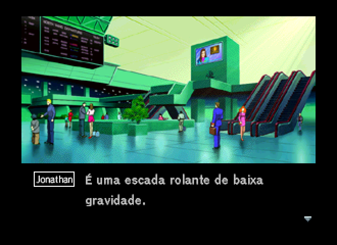
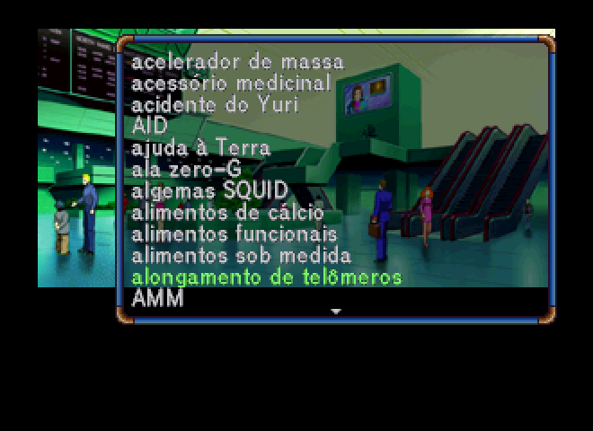
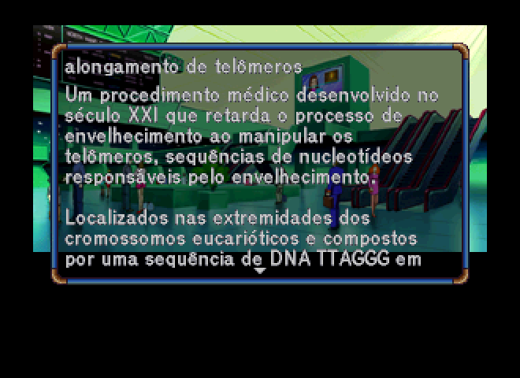
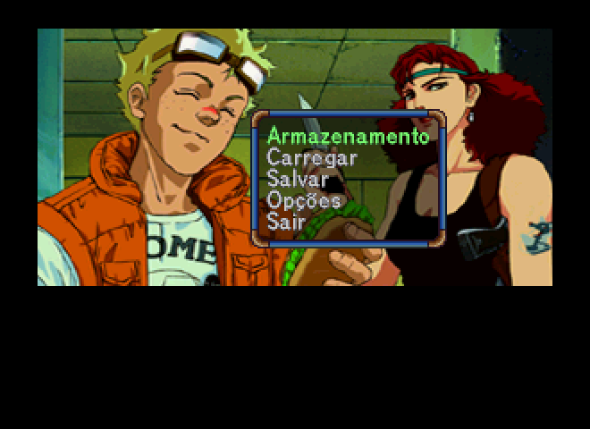

# Policenauts em português (Sega Saturn)

Policenauts é a aventura de Hideo Kojima que a Konami lançou no Japão para PC-98 em 1994, com versões para 3DO em 1995 e para PlayStation e Sega Saturn em 1996, todas só no Japão.

Esta tradução parte do patch em inglês 1.0.1 do Policenauts Translation Project, sem o qual esta versão não existiria. Em cima desse trabalho, falas, menus, glossário e legendas passaram para o português do Brasil, com acentuação.

> **Aqui não tem jogo, ROM nem ISO.** Este repositório distribui só o patch, e para usar você precisa ter a sua própria cópia do jogo.

| | |
| --- | --- |
|  |  |
|  |  |
|  |  |
|  |  |

## O que está traduzido

Traduzi as falas, as legendas de voz e as dos vídeos dos Extras, o glossário, os menus, os resumos de cada ato, as telas de texto que estão em imagem e as placas de lugar, tudo com acentuação. Como o glossário agora segue a ordem alfabética em português, cada verbete aparece na letra em que você procuraria.

Ficaram dois detalhes de fora: o menu da tela título não tem acento (sai "Opcoes" e "Salvamento automatico"), e alguns vídeos trazem texto em inglês gravado na própria imagem, com a legenda em português logo abaixo.

## Como aplicar

1. Monte a versão em inglês 1.0.1 seguindo o readme do patch deles ([policenauts.net](http://policenauts.net)). No fim você tem `POLICENAUTS_1-1.ENGLISH.iso`, `POLICENAUTS_1-2.wav` e o mesmo para os discos 2 e 3.
2. Baixe o patch em [Releases](../../releases) e extraia na mesma pasta das ISOs em inglês.
3. Coloque o [xdelta3](https://github.com/jmacd/xdelta-gpl/releases) na pasta (no Windows, renomeie o executável para `xdelta3.exe`).
4. Rode `aplicar.bat` no Windows ou `aplicar.sh` no Linux e no macOS.
5. Abra `POLICENAUTS_1.PTBR.cue` no emulador ou grave os discos. Os `.wav` são os mesmos da versão em inglês.

O patch só aplica na ISO que sai do patch inglês oficial, e as ISOs "já em inglês" que circulam prontas costumam ter outro layout, que o xdelta recusa com erro de checksum. Se isso acontecer, confira o SHA-1:

| Disco | ISO em inglês (entrada) | ISO em português (saída) |
| --- | --- | --- |
| 1 | `19538c0ec199c41fabd5e3a26edf9a6d43888ea0` | `cab037a04efa1a2e4aa71c30af72a59b00c79b0e` |
| 2 | `617173d28252aab657f068c16efa21c41c07eae9` | `5c54b7596263cfef97111d42a1dc1b1c2f996f6a` |
| 3 | `50b1aa207301c0e72601bf6ef5963c88da5bcace` | `d2507db56ee057943a7dec9644fc9424a1027d96` |

## Observações

Os saves da versão em inglês funcionam, mas a lista "Recentes" do glossário pode mostrar outros verbetes, já que a ordem mudou. Junto do patch vai o `_Brasoes.jpg`, a cola dos brasões de família para a parte das senhas, que é a imagem do patch inglês com o texto em português.

## Créditos

- **Tradução para o português:** Zank-44
- **Tradução em inglês e patch original:** Policenauts Translation Project ([policenauts.net](http://policenauts.net)). Programação: GameZelda, FacundoARG, SaturnAR, Raizing, SkyBladeCloud. Tradução: Marc Laidlaw, Raizing, cafe-alpha. Gráficos: IlDucci.

POLICENAUTS © 1994, 1996 Konami Digital Entertainment. Projeto de fã, gratuito e sem nenhum vínculo com a Konami.
